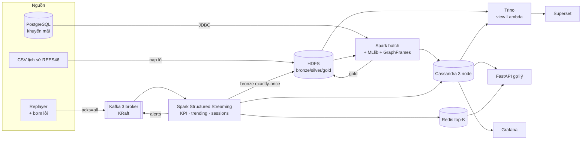

# ShopPulse — Phân tích hành vi khách hàng & gợi ý sản phẩm thời gian thực

Bài tập lớn môn **Lưu trữ và xử lý dữ liệu lớn (IT4931)** — nhóm 5 người.

> Repo chính của nhóm. Mỗi thành viên đưa phần việc của mình vào, chạy kiểm tra rồi commit bằng tài khoản của mình.
> Mã nguồn được phát triển từ một bản tham chiếu dựng với sự hỗ trợ của công cụ AI
> (cách làm: [docs/ke-hoach/porting-guide.md](docs/ke-hoach/porting-guide.md)). Số liệu trong repo này do nhóm tự đo.

ShopPulse nhận luồng sự kiện xem / thêm giỏ / mua hàng của một sàn thương mại điện tử
(285 triệu sự kiện thật của bộ REES46). Hệ thống tính KPI theo từng phút, phát hiện
phiên bỏ giỏ và bot, chấm điểm khả năng mua của phiên đang mở và gợi ý sản phẩm.
Kiến trúc là **Lambda**: speed layer và batch layer được đối soát với nhau. Toàn bộ hệ
thống chạy trên **Kubernetes**.



## Bám sát môn học

| Chương | Thể hiện trong dự án |
|---|---|
| 1. Tổng quan | Phân tích 5V có số liệu, tầng silver làm sạch dữ liệu ([docs/eda.md](docs/eda.md)) |
| 2. Hadoop ecosystem | HDFS, Hive Metastore, JDBC thay Sqoop, Airflow thay Oozie, K8s thay YARN ([ADR-0002](docs/adr/0002-kubernetes.md)) |
| 3. HDFS | Replication 3, fsck, tắt DataNode để kiểm chứng tái nhân bản, benchmark CSV/JSON/Avro/Parquet/ORC |
| 4.1 NoSQL | Redis (key-value), Cassandra (column family), đồ thị sản phẩm |
| 4.2 CAP | Thí nghiệm ONE vs QUORUM khi chia cắt mạng ([tests/chaos/cassandra_cap.sh](tests/chaos/cassandra_cap.sh)) |
| 4.3 DynamoDB | Cassandra hiện thực vnode, N/R/W, hinted handoff, Merkle repair, gossip |
| 4.6 Presto | Trino: truy vấn liên nguồn HDFS + Cassandra, view Lambda, EXPLAIN ANALYZE |
| 5. Kafka | Partition theo user, ISR, acks=all, 3 consumer group, topic compacted, ACL |
| 6. MapReduce | 2 job Hadoop Streaming có combiner, so sánh với Spark ([mapreduce/](mapreduce/)) |
| 7. Spark | Batch layer: window, pivot, UDF/UDAF, 3 chiến lược join, bucketing, cache, AQE, RDD vs DataFrame |
| 8. Structured Streaming | Watermark, event-time window, stateful + timeout, foreachBatch idempotent, exactly-once |
| 9. Lambda | Kiến trúc chính + job đối soát speed vs batch |
| 10. Spark ML | Pipeline (Transformer/Estimator), ALS, GBT, KMeans, GraphFrames, time series, thống kê |

Danh sách đầy đủ các yêu cầu kỹ thuật của giảng viên, kèm vị trí trong code:
[docs/report/bao-cao.md § 3.5](docs/report/bao-cao.md).

## Chạy thử trên một máy trong 10 phút (không cần Kubernetes)

Yêu cầu: Python 3.11, **Java 17** (Java 21 trở lên làm hỏng pandas UDF của Spark 3.5), khoảng 6 GB RAM trống.

```bash
python -m venv .venv && source .venv/bin/activate
pip install -r requirements-dev.txt
make test                 # 39 test: unit + integration (Spark local)
make local-pipeline       # sinh dữ liệu mẫu → toàn bộ pipeline → docs/results.md
make api-local            # http://localhost:8000/docs
```

Muốn chạy trên dữ liệu thật: `make download-data`, rồi chạy `EVENTS=0 make local-pipeline`.

## Triển khai lên Kubernetes

Hướng dẫn từng bước nằm trong [docs/runbook.md](docs/runbook.md). Tóm tắt:

```bash
bash infra/k3s/install-server.sh            # laptop 1; các laptop còn lại dùng join-agent.sh
make helm-repos images images-k3s
cp infra/k8s/security/secrets.example.yaml infra/k8s/security/secrets.yaml   # điền mật khẩu
make k8s-core k8s-compute k8s-monitoring k8s-serving
make load-history trino-tables streaming-up replay
```

## Cấu trúc repo

```
conf/            cấu hình theo profile (local | k8s)
shoppulse/       thư viện dùng chung: config, SparkSession, schema, UDF, luật chất lượng dữ liệu
ingestion/       sinh dữ liệu mẫu, CSV → bronze, replayer + bơm lỗi, PostgreSQL/JDBC, Avro schema   [TV1, TV2]
batch/           silver, gold, tối ưu, đối soát, gom file nhỏ, benchmark định dạng, EDA              [TV2]
streaming/       bronze sink, KPI/phút, trending, sessionization + chấm điểm, sink, metric           [TV3]
ml/              đặc trưng, dự đoán mua, ALS, KMeans, đồ thị, chuỗi thời gian, thống kê              [TV4]
mapreduce/       Hadoop Streaming mapper/combiner/reducer + so sánh với Spark                        [TV1]
serving/         Cassandra CQL, Trino (DDL, view), API FastAPI, export gold → Cassandra                [TV5]
airflow/dags/    DAG batch hằng đêm + khuôn SparkApplication                                         [TV2]
infra/           manifest K8s, Dockerfile, script k3s/kind
dashboards/      Grafana (sinh bằng mã), truy vấn Superset
tests/           unit, integration, chaos
benchmarks/      kết quả JSON + script tổng hợp + locust
docs/            báo cáo, 11 lessons learned, ADR, runbook, kế hoạch 12 tuần, báo cáo tuần
```

## Nhóm

| Vai | Phụ trách | Lessons learned |
|---|---|---|
| TV1 — Platform & Ingestion | k3s, Kafka, PostgreSQL, Hive Metastore, Trino, Airflow, Superset (triển khai), replayer, MapReduce, bảo mật, CI | 01, 05, 10 |
| TV2 — Batch Layer | thư viện `shoppulse/`, silver/gold, tối ưu Spark, DAG Airflow, đối soát, scaling | 02, 04, 06 |
| TV3 — Speed Layer | image Spark + Spark Operator, Structured Streaming, sessionization, chấm điểm realtime | 03, 11 |
| TV4 — ML & Analytics | HDFS, EDA, MLlib, GraphFrames, time series, thống kê, Superset | 08 |
| TV5 — Serving, Giám sát & Kiểm thử | Cassandra, Redis, view Lambda trên Trino, API, Prometheus/Grafana, khung test, chaos | 07, 09 |

Kế hoạch 12 tuần: [docs/plan.md](docs/plan.md) · Việc từng tuần: [docs/weekly/](docs/weekly/) ·
Danh mục file theo tuần: [docs/ke-hoach/file-index.md](docs/ke-hoach/file-index.md) · Bản PDF có sơ đồ: [docs/ke-hoach/](docs/ke-hoach/)
