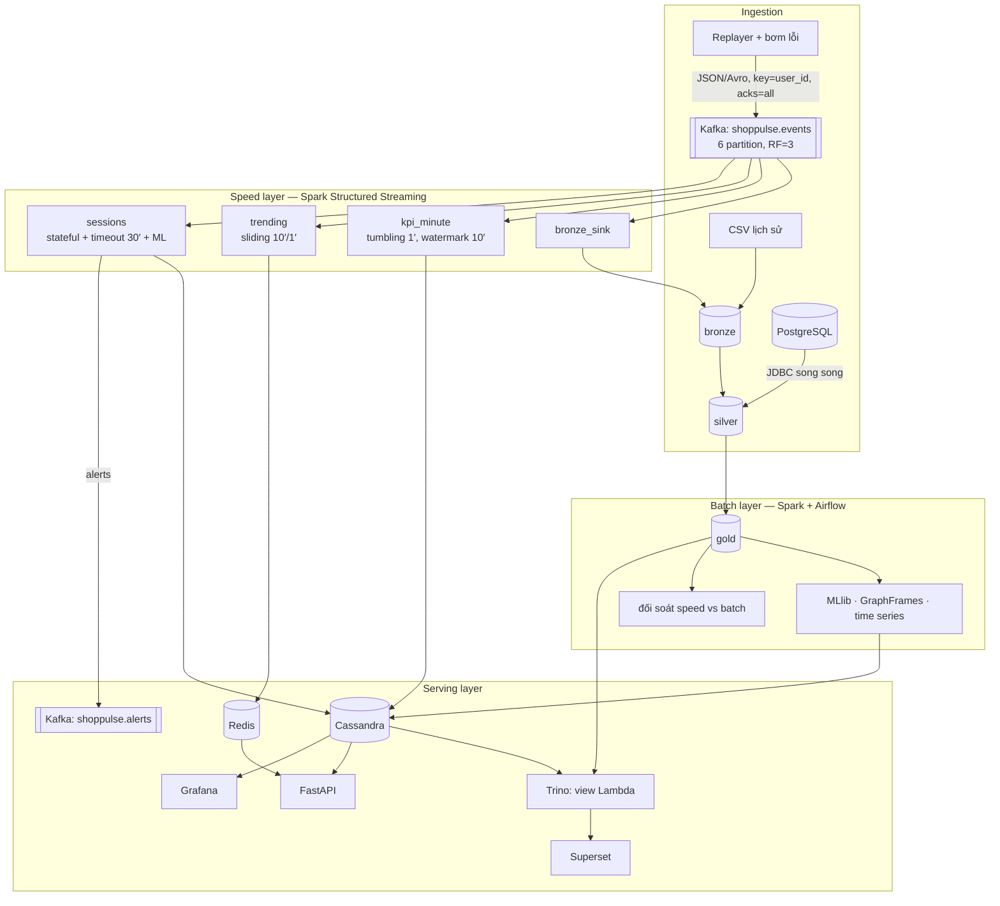
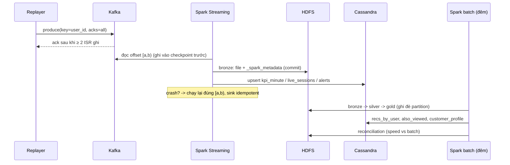

# BÁO CÁO BÀI TẬP LỚN — LƯU TRỮ VÀ XỬ LÝ DỮ LIỆU LỚN (IT4931)

**Đề tài:** ShopPulse — Nền tảng phân tích hành vi khách hàng và gợi ý sản phẩm thời gian thực cho sàn thương mại điện tử theo kiến trúc Lambda trên Kubernetes

**Nhóm:** TV1 · TV2 · TV3 · TV4 · TV5 (điền họ tên, MSSV) · **Giảng viên:** TS. Trần Việt Trung · **Học kỳ:** 2026.1

> Bản nháp này đã có sẵn nội dung các phần thiết kế và hiện thực. Mọi số liệu đánh dấu
> _(local)_ được đo trên dữ liệu mẫu 300 nghìn sự kiện bằng `make local-pipeline`. Trước khi
> nộp, thay bằng số đo trên cụm với dữ liệu thật (tuần 9–11) và sinh lại `docs/results.md`.

---

## 1. Đặt vấn đề

### 1.1 Bối cảnh

Các sàn thương mại điện tử như Shopee, Tiki hay Lazada ghi nhận hàng trăm triệu lượt tương tác mỗi ngày. Giá trị của dữ liệu này giảm rất nhanh theo thời gian: một phiên bỏ giỏ chỉ đáng gửi voucher nhắc trong vài chục phút, và "sản phẩm đang hot" chỉ đúng trong vài phút. Mặt khác, báo cáo tài chính, phân khúc khách hàng và mô hình gợi ý lại cần tính chính xác trên toàn bộ lịch sử. Nhu cầu vừa nhanh vừa đúng này chính là bài toán mà kiến trúc Lambda (slide chương 9) được thiết kế để giải.

### 1.2 Câu hỏi nghiệp vụ

| # | Câu hỏi | Lớp | Người dùng |
|---|---|---|---|
| Q1 | Mỗi phút có bao nhiêu lượt xem, thêm giỏ, mua; doanh thu và tỉ lệ chuyển đổi theo danh mục là bao nhiêu? | Speed | Vận hành flash sale |
| Q2 | Sản phẩm nào hot trong 10 phút gần nhất? | Speed | Trang chủ |
| Q3 | Phiên nào bỏ giỏ (thêm giỏ nhưng 30 phút không mua)? | Speed | Marketing (remarketing) |
| Q4 | Tài khoản nào có hành vi giống bot? | Speed | Chống gian lận, chống cào giá |
| Q5 | Phiên đang mở có xác suất mua bao nhiêu? | Speed + ML | CSKH |
| Q6 | Nên gợi ý gì cho từng khách; sản phẩm nào hay được xem cùng nhau? | Batch + ML + Graph | Cá nhân hoá |
| Q7 | Khách hàng chia thành những phân khúc nào; phễu rơi ở đâu; khuyến mãi có hiệu quả không? | Batch | CRM, ban giám đốc |
| Q8 | Doanh thu từng danh mục những ngày tới dự báo bao nhiêu; ngày nào bất thường? | Batch + time series | Kế hoạch kho, tài chính |

### 1.3 Dữ liệu

| Nguồn | Mô tả | Kiểu |
|---|---|---|
| REES46 eCommerce behavior ([Kaggle](https://www.kaggle.com/datasets/mkechinov/ecommerce-behavior-data-from-multi-category-store), [REES46](https://rees46.com/en/datasets)) | 285 triệu sự kiện, 10/2019–4/2020, 9 cột: `event_time, event_type, product_id, category_id, category_code, brand, price, user_id, user_session` | Bán cấu trúc (CSV → Avro/JSON → Parquet) |
| Lịch khuyến mãi | Chiến dịch flash sale theo danh mục và khung giờ, do nhóm sinh (`ingestion/promotions.py`) | Quan hệ (PostgreSQL) |
| Luồng realtime | Replayer phát lại REES46 theo nhịp thời gian thật, có bơm lỗi có kiểm soát | Luồng sự kiện (Kafka) |

### 1.4 Vì sao đây là bài toán Big Data (5V)

| V | Biểu hiện | Hệ quả thiết kế |
|---|---|---|
| Volume | 109.950.743 sự kiện, CSV 13,7 GB, Parquet 8,6 GB, 61 ngày (tháng 10–11/2019) | Không thể xử lý bằng pandas trên một máy 16 GB → Spark + HDFS, định dạng cột nén |
| Velocity | Tháng 11/2019 trung bình 67,5 triệu / 30 ngày ≈ 26 sự kiện/giây; phát lại ×60 ≈ 1.560/giây; flash sale ×10 ≈ 15.600/giây | Kafka để đệm và tách nguồn khỏi bên xử lý; Structured Streaming micro-batch |
| Variety | Sự kiện bán cấu trúc, danh mục phân cấp, bảng quan hệ, đồ thị sản phẩm, mô hình ML | Nhiều mô hình lưu trữ: HDFS/Parquet, Cassandra (column family), Redis (key-value), đồ thị |
| Veracity | Khoảng 32% thiếu `category_code`, 17% thiếu `brand`, đơn mua giá 0, bản ghi trùng, bot, sự kiện đến trễ _(local, [docs/eda.md](../eda.md))_ | Tầng silver với luật chất lượng dữ liệu dùng chung cho cả batch và stream; watermark; khử trùng theo `event_id` |
| Value | 8 câu hỏi trên, mỗi câu có dashboard hoặc API | Serving layer: Trino, Superset, Grafana, FastAPI |

### 1.5 Phạm vi và giới hạn

- Dữ liệu là của một sàn nước ngoài giai đoạn 2019–2020. Kết luận nghiệp vụ chỉ mang tính minh hoạ.
- Luồng realtime được phát lại từ dữ liệu lịch sử. Bù lại, nhóm biết trước "sự thật" nên đo được chính xác sai lệch của speed layer, và bơm lỗi có kiểm soát để kiểm thử.
- Cụm chạy trên 2–3 laptop nối qua Tailscale. Số đo hiệu năng mang tính tương đối, dùng để so sánh các phương án với nhau.
- Không dùng Kerberos và TLS nội bộ vì vượt phạm vi môn học. Các biện pháp bảo mật đã áp dụng được trình bày ở lesson 10.

---

## 2. Kiến trúc và thiết kế

### 2.1 Tổng quan: kiến trúc Lambda trên Kubernetes

Các nguyên tắc thiết kế:

1. **Bronze bất biến.** Dữ liệu gốc không bao giờ bị sửa (ngữ nghĩa *immutable-shared-files*, slide 3.1). Mọi lỗi logic đều sửa được bằng cách chạy lại batch từ bronze. Đây là lợi thế cốt lõi của Lambda.
2. **Một định nghĩa, hai lớp.** Luật chất lượng dữ liệu (`shoppulse/quality.py`), `event_id` (`shoppulse/schemas.py`) và đặc trưng ML (`ml/features.py`) được dùng chung cho batch và stream, nhờ vậy hai lớp cho cùng kết quả (kiểm chứng ở § 4.1).
3. **Idempotent ở mọi nơi ghi.** Ghi lại một lần nữa không làm sai kết quả: bronze dùng file sink có log, Cassandra upsert theo khoá chính, Redis ghi đè, silver/gold ghi đè theo partition.
4. **Cấu hình theo profile.** Cùng một mã chạy ở `local` (file, Parquet) và `k8s` (Kafka, HDFS, Cassandra) — `conf/shoppulse.yaml`.

### 2.2 Thành phần và vai trò

| Thành phần | Công nghệ | Vai trò | Liên hệ slide |
|---|---|---|---|
| Message queue | Kafka 4.0 (KRaft) qua Strimzi, 3 broker | Đệm và tách rời nguồn/đích, cho phép phát lại 7 ngày | Ch.5 |
| Lưu trữ phân tán | HDFS 3.4 (1 NameNode, 3 DataNode), Parquet + Snappy | Data lake bronze/silver/gold | Ch.3 |
| Xử lý batch | Spark 3.5.7 (PySpark) trên K8s qua Spark Operator | Làm sạch, tổng hợp, ML | Ch.7, 10 |
| Xử lý stream | Spark Structured Streaming | KPI, trending, sessionization, chấm điểm | Ch.8 |
| NoSQL | Cassandra 4.1 (3 node, RF=3), Redis 7 | Serving realtime, top-K | Ch.4.1–4.3 |
| SQL engine | Trino (Presto) + Hive Metastore | Truy vấn liên nguồn, view Lambda | Ch.4.6, Ch.2 |
| Điều phối | Airflow 2.10 (KubernetesExecutor) | DAG batch hằng đêm | Ch.2 (Oozie) |
| Hiển thị | Superset, Grafana, FastAPI | Dashboard kinh doanh, vận hành, API | — |
| Giám sát | Prometheus, Grafana, Kafka exporter | Lag, thông lượng, độ trễ, cảnh báo | — |
| Hạ tầng | k3s nhiều node (Tailscale), Helm | Yêu cầu Kubernetes của giảng viên | Ch.2 (YARN) |

Lý do chọn từng công nghệ được ghi trong các ADR: [0001 Lambda/Kappa](../adr/0001-lambda-vs-kappa.md) · [0002 Kubernetes](../adr/0002-kubernetes.md) · [0003 Cassandra](../adr/0003-cassandra.md) · [0004 HDFS](../adr/0004-hdfs.md) · [0005 định dạng](../adr/0005-file-formats.md) · [0006 Spark 3.5](../adr/0006-spark-version.md).

### 2.3 Luồng dữ liệu của một sự kiện

### 2.4 Thiết kế data lake

| Tầng | Bảng | Partition | Ghi chú |
|---|---|---|---|
| bronze | `events_batch`, `events_stream` | `event_date` | Giữ nguyên dữ liệu gốc + `event_id`. Chứa `user_id` gốc nên chỉ Spark được đọc (HDFS ACL) |
| silver | `events`, `events_quarantine`, `dim_product`, `dim_user`, `dim_promotion` | `event_date` | Đã làm sạch, khử trùng, băm `user_id` → `user_key`, làm giàu danh mục/giá/khuyến mãi |
| gold | 20 bảng tổng hợp và kết quả ML (xem [data dictionary](../data-dictionary.md)) | theo ngày nếu lớn | Nguồn cho Trino, Superset, Cassandra |

### 2.5 Thiết kế Kafka

- Topic `shoppulse.events` có 6 partition (= số task đọc song song tối đa) và RF=3, `min.insync.replicas=2`. Producer dùng `acks=all` và idempotent, nên chịu được mất 1 broker mà không mất bản ghi đã commit.
- Key là `user_id`: mọi sự kiện của một người dùng vào cùng partition, giữ thứ tự theo user (thứ tự chỉ được đảm bảo trong partition — slide 5).
- 3 consumer group độc lập (`shoppulse-bronze`, `shoppulse-kpi`, `shoppulse-sessions`…): mỗi group giữ offset riêng, tương đương 3 subscriber.
- `shoppulse.products` là topic compacted, chỉ giữ bản ghi mới nhất cho mỗi sản phẩm.
- Bảo mật: SCRAM-SHA-512 và ACL tối thiểu cho từng người dùng (`infra/k8s/kafka/users.yaml`).

### 2.6 Thiết kế Cassandra

Các bảng được thiết kế theo nguyên tắc query-first: mỗi bảng phục vụ một truy vấn, và mỗi truy vấn chỉ chạm một partition. RF=3; ghi `LOCAL_QUORUM` (W=2); đọc dashboard dùng `ONE`, đọc cần chính xác dùng `LOCAL_QUORUM` (R=2, R+W>N). Chi tiết: [docs/cassandra-data-model.md](../cassandra-data-model.md).

---

## 3. Chi tiết hiện thực

### 3.1 Mã nguồn

| Thư mục | Nội dung | Số file Python |
|---|---|---|
| `shoppulse/` | config, SparkSession, schema, UDF/UDAF, luật chất lượng dữ liệu, I/O | 6 |
| `ingestion/` | sinh dữ liệu mẫu, CSV→bronze, replayer, bơm lỗi, PostgreSQL/JDBC | 5 |
| `batch/` | silver, 3 job gold, tối ưu, đối soát, gom file nhỏ, benchmark định dạng, RDD vs DF, EDA | 10 |
| `streaming/` | nguồn chung, 4 job, sink, metric | 7 |
| `ml/` | đặc trưng, 6 mô hình/phân tích | 7 |
| `serving/`, `mapreduce/`, `airflow/` | API, export, Trino DDL; Hadoop Streaming; DAG | 10 |

### 3.2 Batch layer

- **Silver** (`batch/silver.py`): gắn mã lỗi DQ → cách ly vào `events_quarantine`, khử trùng theo `event_id`, băm PII bằng SHA-256 có salt, tách danh mục 3 cấp bằng pandas UDF, gắn khuyến mãi bằng broadcast join. Lịch khuyến mãi được "trải" thành các ô (danh mục, giờ) để biến range join thành equi-join nhỏ.
- **Gold KPI** (`batch/gold_kpis.py`): `ROLLUP` sinh thêm dòng `all`; `PIVOT` phễu và heatmap 24 giờ; `UNPIVOT` cho Superset; window lũy kế, MA7 và tăng trưởng theo ngày.
- **Gold khách hàng** (`batch/gold_customers.py`): tái dựng phiên bằng chuỗi `lag → cờ phiên mới → sum lũy kế`; RFM chấm điểm bằng `approxQuantile` (song song) thay vì `ntile` trên cửa sổ toàn cục (dồn về 1 partition); Python UDF gán nhãn phân khúc.
- **Gold sản phẩm** (`batch/gold_products.py`): top-N bằng `row_number`; hệ số Gini bằng pandas UDAF; cặp sản phẩm xem cùng phiên sinh bằng hàm bậc cao trên mảng, tránh self-join bùng nổ.

### 3.3 Speed layer và exactly-once

Exactly-once end-to-end = **nguồn phát lại được** (offset Kafka) + **checkpoint/WAL** (offset và state trên HDFS) + **sink idempotent** (slide chương 8):

| Job | Kỹ thuật | Sink và cách đảm bảo idempotent |
|---|---|---|
| `bronze_sink` | append, partition ngày | File sink có log `_spark_metadata`: chỉ file của batch đã commit mới hiện ra với người đọc |
| `kpi_minute` | watermark 10′, `dropDuplicatesWithinWatermark`, stream-static join, cửa sổ tumbling, update mode | Cassandra upsert theo `(day, cat_l1, window_start)` |
| `trending` | cửa sổ trượt 10′/1′, top-K | Redis: ghi khoá tạm rồi `RENAME` (nguyên tử) |
| `sessions` | `applyInPandasWithState`, timeout theo event-time, RocksDB state store | Cassandra theo `session_id`; alert có `alert_id` tất định để bên nhận khử trùng |

Kiểm chứng: `tests/integration/test_streaming_exactly_once.py` bơm 5% bản ghi trùng, chạy streaming 3 lần (lần 2 có thêm dữ liệu, lần 3 không có gì mới). Kết quả khớp tuyệt đối với tính toán độc lập bằng pandas.

### 3.4 Phân tích nâng cao

| Bài toán | Hiện thực | Đánh giá |
|---|---|---|
| Dự đoán mua | Pipeline StringIndexer → OneHotEncoder → VectorAssembler → GBT (so với Logistic Regression), trọng số lớp, chia train/test theo thời gian | AUC-ROC, AUC-PR, precision/recall |
| Gợi ý | ALS implicit (confidence = log1p Σ trọng số hành vi), loại sản phẩm đã xem | Precision/NDCG/MAP/Recall@10 so với baseline phổ biến |
| Phân khúc | KMeans trên log-RFM chuẩn hoá, chọn k theo silhouette | Silhouette, hồ sơ cụm |
| Đồ thị | GraphFrames: PageRank, label propagation, connected components; PageRank tự cài để so sánh | Top sản phẩm trung tâm, số cộng đồng |
| Chuỗi thời gian | MA7, z-score 14 ngày, Holt + mùa vụ theo thứ, chạy song song từng danh mục bằng `applyInPandas` | WAPE backtest so với naive mùa vụ |
| Thống kê | Tương quan Pearson/Spearman, `approxQuantile`, kiểm định chi-square | p-value |

### 3.5 Đối chiếu yêu cầu kỹ thuật của giảng viên

| Yêu cầu | Vị trí trong mã |
|---|---|
| Window functions | `gold_customers.rebuild_sessions` (lag, sum lũy kế), `gold_products.top_products` (row_number), `gold_kpis.revenue_trend`, `ml/timeseries` (rowsBetween) |
| Pivot / unpivot | `gold_kpis.funnel` (pivot + `unpivot`), `gold_kpis.hourly_heatmap` |
| Custom aggregation | `shoppulse/udfs.gini_udaf`, `median_udaf` (pandas UDAF) |
| Nhiều stage biến đổi / chuỗi phức tạp | bronze → silver → gold; `rebuild_sessions`; `coview_pairs` (transform/slice/flatten) |
| UDF nghiệp vụ | `split_category`, `price_bucket` (pandas UDF), `segment_label` (Python UDF); so sánh ở `optimization.exp_udf` |
| Broadcast join | `silver.enrich` (khuyến mãi), `kpi_minute.transform` (stream-static), `optimization.exp_join` |
| Sort-merge join | `optimization.exp_join` (sự kiện × user_features), `reconciliation.reconcile` |
| Tối ưu nhiều join | bucketing 2 phía (`exp_join`), salting (`exp_skew`), AQE skew join |
| Partition pruning, bucketing | partition `event_date` mọi bảng lớn; `exp_pruning`; `exp_join` bucketed |
| Caching / persistence | `exp_cache` (4 storage level); `.cache()` trong gold và ML |
| Execution plan | `docs/plans/*.txt`; `exp_aqe` |
| Output modes | append (`bronze_sink`), update (`kpi_minute`, `trending`, `sessions`), complete (nêu trong lesson 03) |
| Watermark, dữ liệu trễ | mọi job stateful; metric `rows_dropped_by_watermark` |
| Quản lý state | `streaming/sessions.py` (applyInPandasWithState, timeout, RocksDB) |
| Exactly-once | § 3.3 và test tích hợp |
| MLlib | `ml/purchase_propensity.py`, `als_recommender.py`, `segmentation.py` |
| GraphFrames | `ml/product_graph.py` |
| Thống kê | `ml/stats.py` |
| Time series | `ml/timeseries.py` |
| Kafka · HDFS · NoSQL · K8s | `infra/k8s/*` |

### 3.6 Cấu hình môi trường

- `conf/shoppulse.yaml`: hai profile. Mọi khoá ghi đè được bằng biến môi trường `SHOPPULSE_*`.
- Bí mật nằm trong Secret `shoppulse-secrets`, mẫu tại `infra/k8s/security/secrets.example.yaml`, không bao giờ commit.
- Image: `infra/docker/spark` (Spark 3.5.7, JAR Kafka/Avro/Cassandra/GraphFrames/PostgreSQL tải sẵn lúc build), `serving/api`, `infra/docker/replayer`, `infra/docker/hive-metastore`.

### 3.7 Chiến lược triển khai

- Cụm k3s gồm 2–3 laptop nối qua Tailscale, dự phòng kind trên một máy. Có 5 namespace, NetworkPolicy chặn mặc định với các namespace dữ liệu, và ResourceQuota cho namespace compute.
- Thứ tự dựng: `make k8s-core` (Kafka, HDFS, Cassandra, Redis, PostgreSQL) → `k8s-compute` (Spark Operator, Hive Metastore, Trino, Airflow) → `k8s-monitoring` → `k8s-serving`. Chi tiết trong [runbook](../runbook.md).
- Job streaming là `SparkApplication` với `restartPolicy: Always`. Job batch do Airflow tạo từ khuôn `airflow/dags/templates/spark_batch.yaml`, có dynamic allocation.
- Anti-affinity giữa broker Kafka, DataNode và node Cassandra, để mất 1 laptop không làm mất dữ liệu.

### 3.8 Giám sát

- Listener `streaming/metrics.py` xuất tốc độ vào/xử lý, thời gian batch, số dòng state, số sự kiện bị watermark loại và độ trễ watermark.
- Kafka exporter đo consumer lag; JMX exporter theo dõi partition thiếu bản sao. API có histogram độ trễ.
- 7 luật cảnh báo (`infra/k8s/monitoring/prometheus-rules.yaml`), 2 dashboard Grafana sinh bằng mã.

### 3.9 Kiểm thử

- 39 test tự động chạy trên CI (Java 17 + Spark local): unit (schema, UDF, bơm lỗi, DQ, gold, state machine của sessionization, MapReduce, API, cấu hình) và integration (exactly-once streaming, pipeline CSV → gold).
- 4 kịch bản chaos trên cụm (`tests/chaos/`), kết quả ghi tại [docs/chaos.md](../chaos.md).

---

## 4. Kết quả thực nghiệm

Toàn bộ bảng số liệu: [docs/results.md](../results.md) _(local)_ và [docs/benchmarks.md](../benchmarks.md) (cụm).

### 4.1 Đối soát Lambda

Lần chạy đầu tiên cho thấy speed layer lệch batch 1 đơn mua và 63,51 đơn vị doanh thu. Nhóm tìm ra 2 nguyên nhân: (1) speed layer chưa áp luật loại đơn mua giá 0; (2) cửa sổ cuối cùng chưa đủ dữ liệu vì luồng dừng giữa phút. Sau khi dùng chung `shoppulse/quality.py` và loại cửa sổ cuối khỏi phép so, speed khớp batch **100%** về lượt xem (52.600) và đơn mua (2.228), sai số doanh thu 0,0%, với 1% bản ghi trùng và 2% bản ghi trễ tới 15 phút _(local)_.

### 4.2 Tối ưu Spark _(local, 300 nghìn dòng, median 3 lần)_

| Thí nghiệm | Kết quả |
|---|---|
| Join | sort-merge 1,12 s (3 Exchange) · broadcast 0,50 s · bucketed 0,54 s (1 Exchange) |
| UDF | Python UDF 1,33 s · pandas UDF 0,69 s · biểu thức native 0,26 s |
| AQE (200 shuffle partition) | tắt 1,05 s · bật 0,27 s |
| Cache (3 truy vấn tái sử dụng) | không cache 0,68 s · MEMORY_AND_DISK 0,35 s |
| Định dạng | Parquet Snappy bằng 25% dung lượng CSV, quét nhanh hơn 3,1×; ORC Zlib 16% |

### 4.3 Học máy _(local)_

| Mô hình | Chỉ số |
|---|---|
| GBT dự đoán mua | AUC-ROC 0,929 · AUC-PR 0,738 (Logistic Regression: 0,918 / 0,665) |
| ALS (chỉ sản phẩm mới) | NDCG@10 0,162 so với baseline phổ biến 0,137 |
| KMeans | k = 6, silhouette 0,527 |
| Holt + mùa vụ | WAPE 0,72 so với naive mùa vụ 0,97 |

---

## 5. Lessons learned

Mỗi bài theo mẫu của giảng viên (vấn đề → các cách đã thử → giải pháp và số đo → bài học), nằm trong thư mục [docs/lessons/](../lessons/):

| # | Chủ đề | Tóm tắt |
|---|---|---|
| 01 | [Data Ingestion](../lessons/01-data-ingestion.md) | `event_id` tất định giúp khử trùng nhất quán giữa đường batch và đường stream |
| 02 | [Spark Processing](../lessons/02-spark-processing.md) | `ntile` trên cửa sổ toàn cục dồn dữ liệu về 1 partition → chuyển sang `approxQuantile` |
| 03 | [Stream Processing](../lessons/03-stream-processing.md) | Kích thước watermark là đánh đổi giữa độ trễ và tỉ lệ sự kiện trễ bị loại |
| 04 | [Data Storage](../lessons/04-data-storage.md) | Small files từ streaming; không được gom file trong thư mục sink |
| 05 | [System Integration](../lessons/05-system-integration.md) | Java 21 và Arrow của Spark 3.5 xung đột → cố định Java 17 |
| 06 | [Performance](../lessons/06-performance.md) | Bucketing loại shuffle; AQE gộp 200 partition nhỏ |
| 07 | [Monitoring](../lessons/07-monitoring-debugging.md) | Listener Python + Prometheus; tìm nguyên nhân gốc từ metric |
| 08 | [Scaling](../lessons/08-scaling.md) | Dữ liệu mẫu không có tín hiệu cá nhân hoá → ALS thua baseline; strong/weak scaling |
| 09 | [Data Quality & Testing](../lessons/09-data-quality-testing.md) | Luật DQ phải dùng chung giữa hai lớp — phát hiện nhờ đối soát |
| 10 | [Security & Governance](../lessons/10-security-governance.md) | Băm PII có salt, ACL Kafka, role Cassandra, HDFS ACL |
| 11 | [Fault Tolerance](../lessons/11-fault-tolerance.md) | Exactly-once cần đủ 3 điều kiện; ONE vs QUORUM |

---

## 6. Kết luận và hướng phát triển

ShopPulse hiện thực đầy đủ kiến trúc Lambda: có hai lớp xử lý, một serving layer và cơ chế đối soát giữa hai lớp bằng số liệu. Mọi yêu cầu kỹ thuật của môn học đều có mã, test và số đo tương ứng. Hướng phát triển:

1. Thay Parquet thuần bằng Apache Iceberg để có ACID, time travel và compaction an toàn cho cả thư mục streaming.
2. Thử nghiệm Kappa: bỏ batch layer, tính lại bằng cách phát lại Kafka; so chi phí và độ phức tạp với Lambda.
3. Mô hình gợi ý theo phiên (sequence-aware) thay cho ALS tĩnh.
4. Bật TLS/Kerberos và đưa Secret sang một kho bí mật chuyên dụng.

## Phụ lục A — Phân công

| Thành viên | Vai | Đóng góp chính | Lessons |
|---|---|---|---|
| TV1 | Platform & Ingestion | Cụm k3s, Kafka, PostgreSQL, Hive Metastore/Trino, Airflow, Superset (triển khai), replayer + bơm lỗi, MapReduce, bảo mật, CI | 01, 05, 10 |
| TV2 | Batch Layer | thư viện chung, silver/gold, UDF/UDAF, tối ưu, DAG Airflow, đối soát, compaction, scaling | 02, 04, 06 |
| TV3 | Speed Layer | image Spark + Spark Operator, 4 job streaming, sink idempotent, chấm điểm realtime | 03, 11 |
| TV4 | ML & Analytics | HDFS, EDA, 6 bài toán ML/thống kê, dashboard Superset, tổng hợp số liệu | 08 |
| TV5 | Serving, Giám sát & Kiểm thử | Cassandra, Redis, view Lambda trên Trino, API, Prometheus/Grafana, khung kiểm thử, load test, chaos | 07, 09 |

## Phụ lục B — Tài liệu tham khảo

Các tài liệu [1]–[17] trong slide chương 1 của môn học, và:

- Armbrust et al., *Structured Streaming: A Declarative API for Real-Time Applications in Apache Spark*, SIGMOD 2018.
- DeCandia et al., *Dynamo: Amazon's Highly Available Key-value Store*, SOSP 2007.
- Hu, Koren, Volinsky, *Collaborative Filtering for Implicit Feedback Datasets*, ICDM 2008.
- Marz & Warren, *Big Data: Principles and best practices of scalable realtime data systems*, Manning 2015.
